# adhocdocs

Tools for working with evidentiary documents from Claude Code.

**This software is a proof of concept and is not intended or suitable for production use.**

The idea:

1. The most flexible and powerful solution puts a coding agent in charge; but
2. A coding agent can delete files, misquote documents, comingle client matters, and do other undesirable things; so
3. We enforce a **separation between a ground truth and the coding agent's environment**.

The real work is in the interface: giving the agent tools for presenting data that leave freedom for unexpected situations while remaining verifiable.

The result is maximum **flexibility and power** while ensuring that final work product is **grounded in a pipeline that does not depend on AI**.

<a href="https://ellbur.github.io/adhocdocs/#chronology-dates"></a>

*Chronological linking between documents.*

<table>
<tr>
<td width="33%" valign="top"><a href="docs/screenshots/entities.png">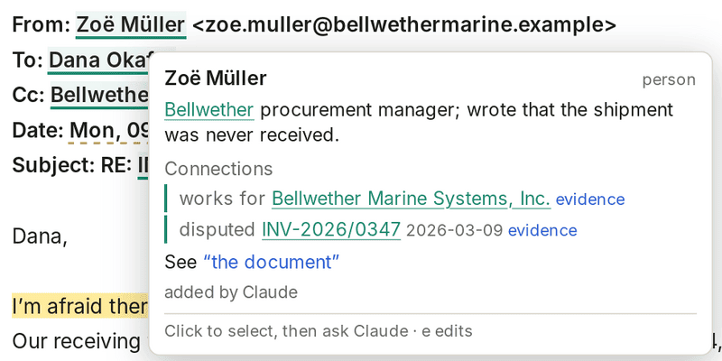</a><br><b>Entities</b> · hover a name</td>
<td width="33%" valign="top"><a href="docs/screenshots/dates.png">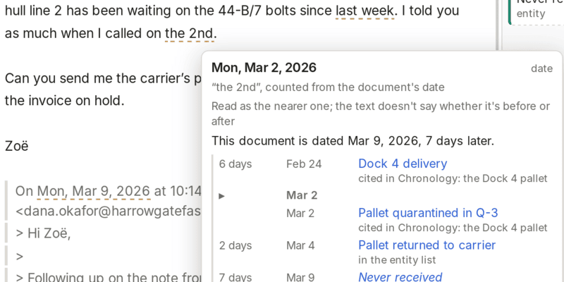</a><br><b>Dates</b> · what came before and after</td>
<td width="33%" valign="top"><a href="docs/screenshots/evidence.png">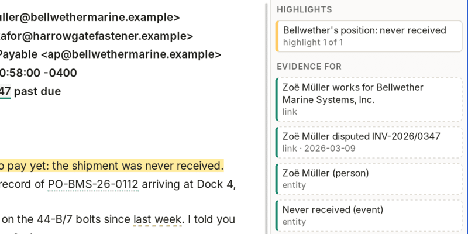</a><br><b>Evidence</b> · what a passage supports</td>
</tr>
<tr>
<td valign="top"><a href="docs/screenshots/pages.png">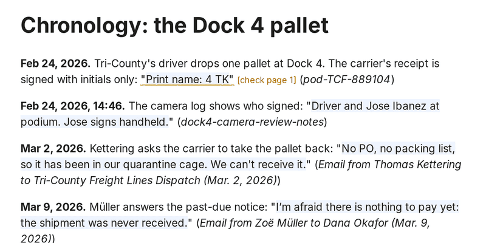</a><br><b>Pages</b> · quotes that are references</td>
<td valign="top"><a href="docs/screenshots/timeline.png">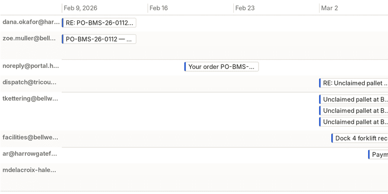</a><br><b>Chronologies</b> · timelines in lanes</td>
<td valign="top"><a href="docs/screenshots/graph.png">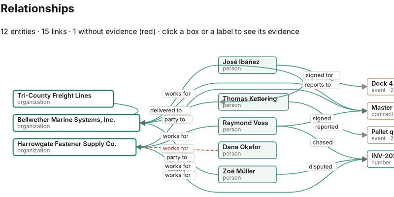</a><br><b>Relationships</b> · links and their evidence</td>
</tr>
<tr>
<td valign="top"><a href="docs/screenshots/trace.png">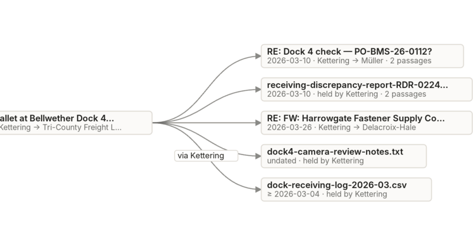</a><br><b>Traces</b> · who knew, and how</td>
<td valign="top"><a href="docs/screenshots/disputes.png">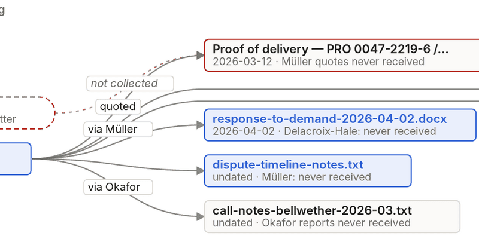</a><br><b>Disputes</b> · who says which side</td>
<td valign="top"><a href="docs/screenshots/threads.png">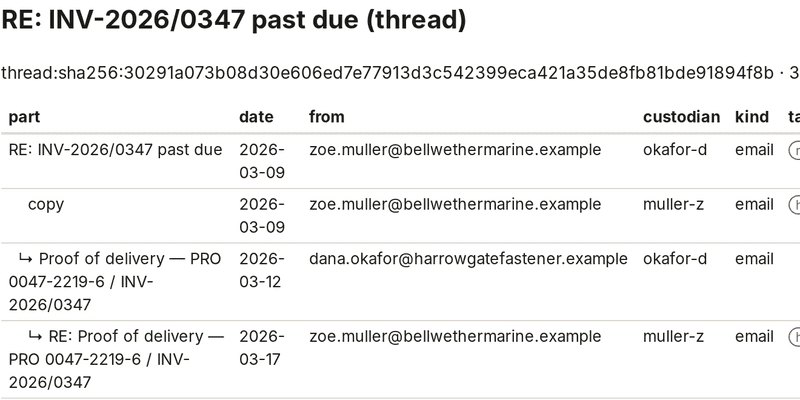</a><br><b>Threads</b> · replies, copies, versions</td>
</tr>
<tr>
<td valign="top"><a href="docs/screenshots/scans.jpg">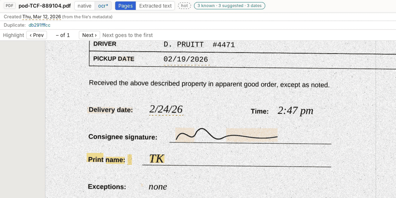</a><br><b>Scans</b> · OCR, quoted to the page</td>
<td valign="top"><a href="docs/screenshots/spreadsheets.png">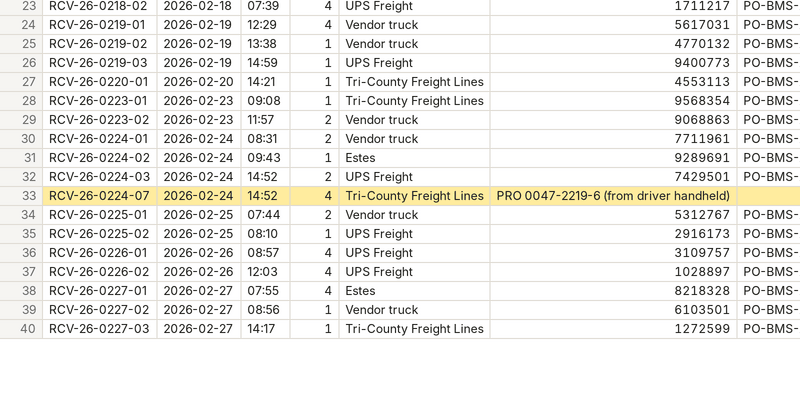</a><br><b>Spreadsheets</b> · cells as citations</td>
<td valign="top"><a href="docs/screenshots/tags.png">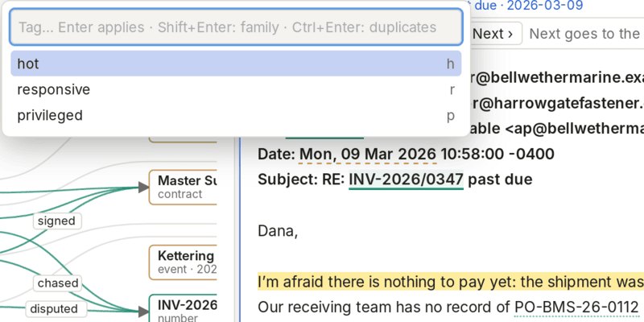</a><br><b>Tags</b> · hotkeys for review</td>
</tr>
</table>

## Setup

Using [uv](https://docs.astral.sh/uv/):

```sh
uv run adhoc gui
```

## Design

[docs/DESIGN.md](docs/DESIGN.md)

For details see module docstrings and `--help`.
